# AI-Powered Job Search & Application Draft Tracker (n8n)

An n8n portfolio workflow for discovering remote jobs, estimating CV-to-job fit using Google Gemini, generating and reviewing **draft** cover letters, and recording new opportunities in Google Sheets. **It does not submit applications.**

## Architecture

```mermaid
flowchart LR
  A[Daily Schedule] --> B[Remote OK API]
  B --> C[Title filter and location flag]
  C --> D[Gemini job evaluation]
  D --> E[Parse and rank]
  E --> F[Match score >= 70]
  F --> G[Gemini cover-letter draft]
  G --> H[Gemini review]
  H --> I[Prepare draft records]
  I --> J[Merge candidate and existing sheet rows]
  I --> K[Google Sheets: Get all rows once]
  K --> J
  J --> L[Deduplicate by application URL]
  L --> M[Append new drafts only]
```

## Scope and observed evidence

- The exported workflow has **29 nodes**. The connected job-source branch uses **Remote OK**. Remotive and Arbeitnow branches are present but disconnected.
- Google Gemini evaluates match, generates draft letters, and revises them. Scores are AI estimates, not employer evaluations.
- A score threshold of **70** filters candidates.
- The Sheets lookup runs once; URL-based deduplication skips previously tracked jobs.
- Manual checks: two candidate records + two existing sheet rows = four merged items, followed by zero new rows. A separate synthetic test collapsed two identical test URLs to one new row.
- The original export had `active: false`; a successful scheduled production run has **not** been verified.

## How to reuse

1. Import [workflow/n8n_public_template.json](workflow/n8n_public_template.json) into n8n.
2. Connect your own Google Gemini and Google Sheets credentials.
3. Set your own spreadsheet and worksheet IDs, and add the required column headers.
4. Replace the bracketed candidate-profile placeholders with a verified profile in your private workflow.
5. Test Gemini JSON outputs, parsers, Merge nodes, Sheets lookup, and duplicate handling before publishing.
6. Configure the Schedule Trigger timezone (the original test used America/Los_Angeles) and publish only after a complete safe test.

**Public template warning:** Sensitive identifiers, credential references, pinned data, and candidate-profile prompts were removed. This template is not immediately runnable.

## Known limitations

- Gemini JSON parsing uses brittle string splitting rather than a robust parser.
- Combine-by-position merges assume stable item ordering.
- Location and work authorization require human verification.
- The two additional job sources are not active in the connected workflow.
- No automatic submission, hiring outcome, or production uptime claim.

See [system design](docs/SYSTEM_DESIGN.md), [test plan](docs/TEST_PLAN.md), [security checklist](docs/SECURITY_CHECKLIST.md), [career material](career/), and [interview Q&A](interview/30_INTERVIEW_QUESTIONS_AND_ANSWERS.md).
